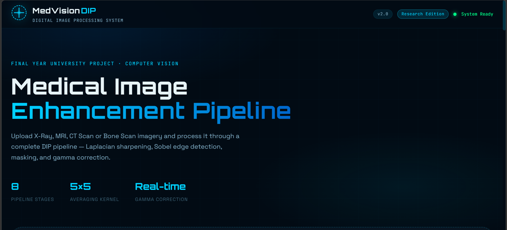
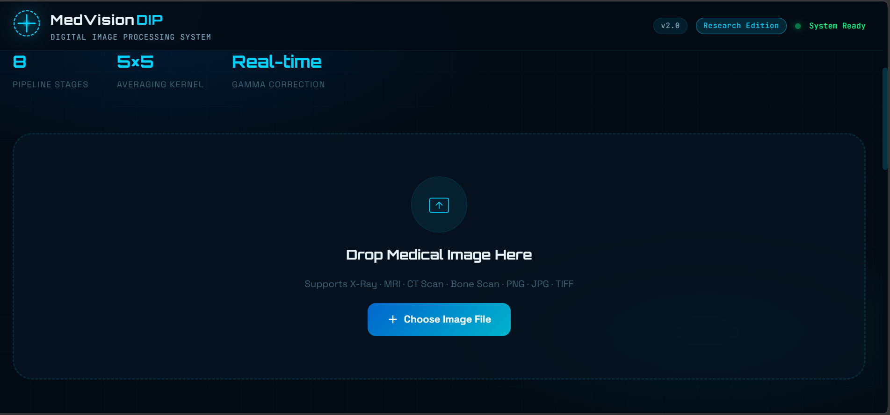
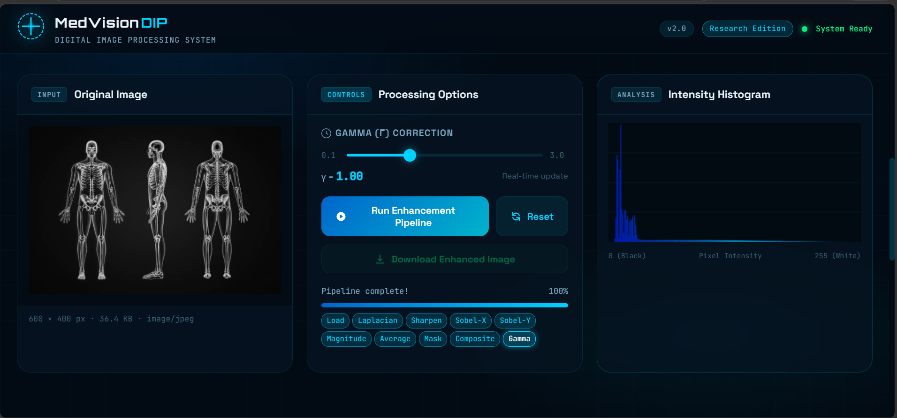
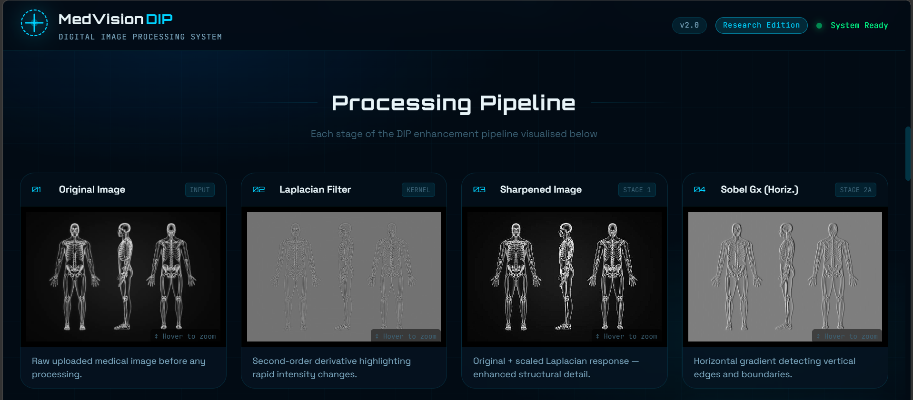
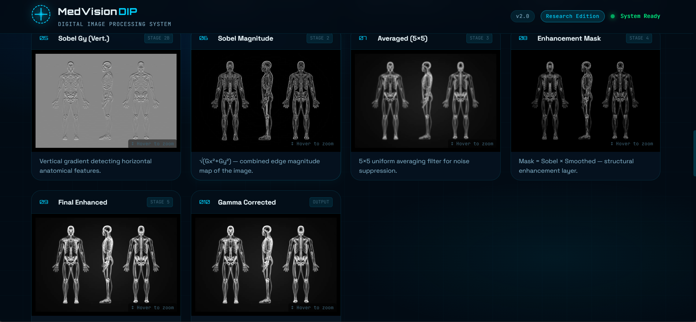
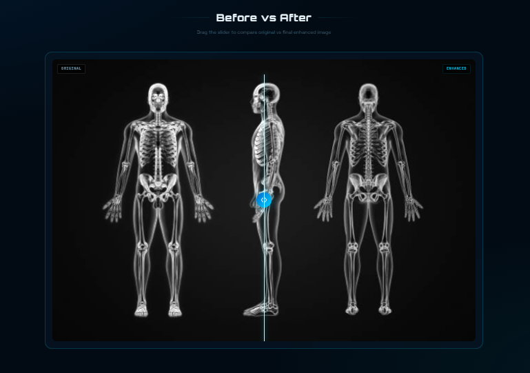
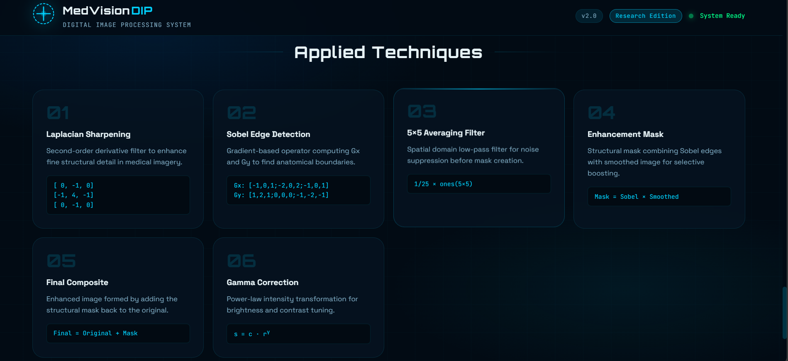

# MedVisionDIP
MedVisionDIP is a medical image processing and quality analysis project designed to enhance, analyze, and improve the visual quality of medical images using Digital Image Processing (DIP) techniques.

Screenshots

